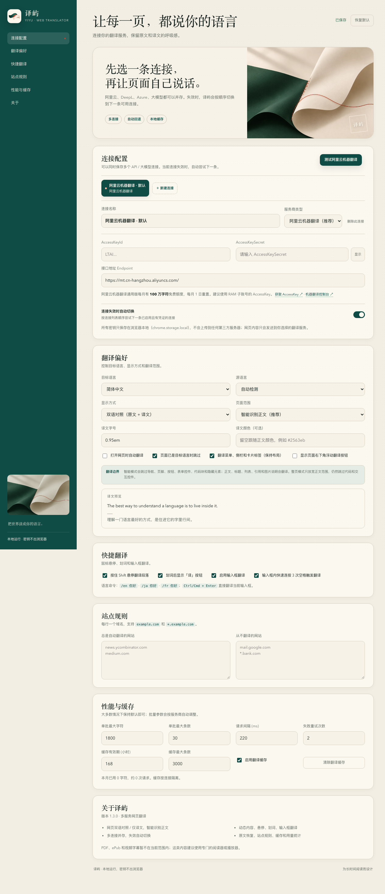
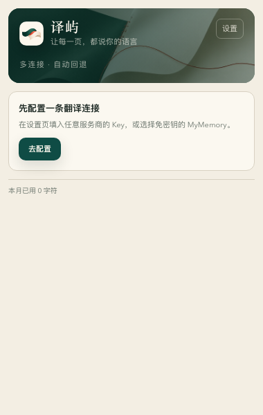

<div align="center">


# YIYU · 译屿

**Let every page speak your language.**

A calm, considered bilingual webpage translator built for long reading sessions.

[](https://github.com/GOBUT/yiyu-web-translator/releases)
[]()
[]()
[]()
[](LICENSE)

**English** · [简体中文](README.md)

</div>

<p align="center">
  
</p>

<p align="center">
  <a href="https://github.com/GOBUT/yiyu-web-translator/releases"><strong>Download</strong></a>
  ·
  <a href="https://github.com/GOBUT/yiyu-web-translator/issues">Report an issue</a>
  ·
  <a href="docs/test-report.md">Test report</a>
</p>

---

## Why YIYU

Translating a page is not just replacing English with Chinese. The hard part is knowing **what to translate, what to leave alone, and how to keep the page looking like itself**.

YIYU:

- Finds article content first and skips navigation, ads, controls and hidden text.
- Keeps the page's visual rhythm with quiet translation rules and readable spacing.
- Shows menus as **original line + translated line**.
- Keeps card modules intact and places a styled translated copy below the original card.
- Never translates CSS, scripts, tooltips or hidden overlays.
- Stores API keys locally in `chrome.storage.local`.

## Features

| | Feature | Notes |
|---|---|---|
| 🪶 | Bilingual reading | Original above, translation below; switch to translation-only |
| 🧭 | Smart content detection | `article` / `main` first; skips navigation, footers, buttons, forms, code and hidden nodes |
| 🧩 | Bilingual UI text | Menu items stack original + translation; card modules get a styled translated copy |
| 🔌 | Multiple providers | Alibaba, Tencent, DeepL, Azure, MyMemory, LibreTranslate |
| 🧠 | Any OpenAI-compatible LLM | Bring your own Base URL, API key and model; sensible defaults |
| 🔎 | Fetch models | Reads `GET /models` and shows the model list |
| 🔁 | Multi-profile fallback | Save multiple connections; automatically switch when one fails |
| 🖱️ | Interactions | Hover, selection, input translation, context menu and shortcuts |
| 💾 | Local cache | Per-connection cache to reduce requests and cost |
| 🔔 | Update notice | Checks GitHub Releases and links to the latest release |

## Screenshots

<p align="center">
  
</p>

<p align="center">
  
</p>

## Installation

### Chrome / Edge / Brave (Chromium)

1. Open [Releases](https://github.com/GOBUT/yiyu-web-translator/releases) and download `yiyu-chromium-v0.1.0.zip`.
2. Extract it into a permanent folder.
3. Open `chrome://extensions` (or `edge://extensions`).
4. Turn on **Developer mode**.
5. Click **Load unpacked** and select the extracted folder.
6. Pin YIYU to the toolbar.

> Tested on Chrome 157. Edge, Brave and other Chromium browsers use the same build and are **not individually tested**.

### Firefox

1. Download `yiyu-firefox-v0.1.0.zip` from [Releases](https://github.com/GOBUT/yiyu-web-translator/releases).
2. Extract it.
3. Open `about:debugging#/runtime/this-firefox`.
4. Click **Load Temporary Add-on** and select `manifest.json`.

> **The Firefox build is untested.** It is provided as an experimental Manifest V3 build. Please report issues at [Issues](https://github.com/GOBUT/yiyu-web-translator/issues).

## Configuration

The default provider is **Alibaba Cloud Machine Translation**, which includes **1 million characters of free translation per month** (reset on the 1st; subject to Alibaba Cloud's current policy). Open Settings, pick a provider and enter your credentials. You can save multiple connections and switch between them at any time.

### LLM

Choose **Large language model**, then fill in:

- `Base URL` — for example `https://api.openai.com/v1`
- `API Key`
- Click **Fetch models** to call `GET {Base URL}/models`
- Choose a model or type one manually

YIYU does not ship vendor presets or free-tier promises. Any OpenAI-compatible `/chat/completions` endpoint works.

## Updates

YIYU checks the repository's GitHub Releases:

- Opening the popup or clicking **Check for updates** in Settings calls the GitHub Releases API.
- When a newer release exists, the popup shows a download link.
- Chromium: download the new `yiyu-chromium-vX.Y.Z.zip`, replace the extracted folder and click **Reload** in `chrome://extensions`.
- Firefox: load the new temporary add-on again.

> Chrome Web Store updates are handled by the store. Builds installed from GitHub Releases use the built-in update notice and manual replacement.

## Build

```bash
npm install
npm run build
npm test
npm run build:browsers
```

`npm run build:browsers` writes Chromium and Firefox artifacts under `release/`. It requires Node.js 20+, `zip`, and Chrome for the optional CRX artifact.

## Project layout

```
src/
  background/          service worker, context menus, shortcuts, messages
  content/             content detection, bilingual UI, renderer
  options/             settings page
  popup/               extension popup
  shared/              providers, cache, update checker
assets/brand/          brand mark and hero art
docs/                  screenshots, test report, release notes
scripts/               build and multi-browser packaging
```

## Privacy

- API keys stay in local `chrome.storage.local`.
- YIYU has no relay server.
- Page text is sent only to the provider you choose.
- Update checks request public GitHub Releases metadata only.

## License

[MIT](LICENSE) © 2026 YIYU contributors

---

<p align="center"><sub>Designed for long reading · paper, ink and a little coral thread.</sub></p>
