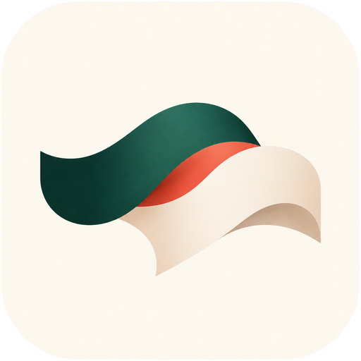
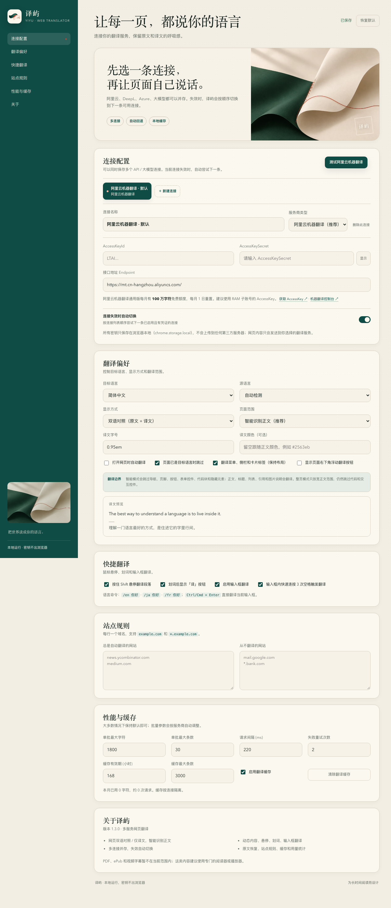
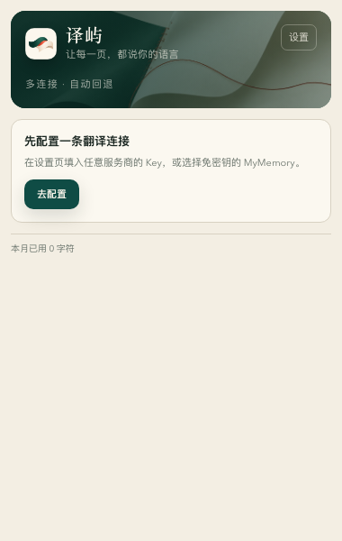

<div align="center">



# 译屿 · YIYU

**让每一页，都说你的语言。**

一个安静、克制、为长时间阅读设计的网页双语翻译扩展。

[](https://github.com/GOBUT/yiyu-web-translator/releases)
[]()
[]()
[]()
[](LICENSE)

[English](README.en.md) · **简体中文**

</div>

<p align="center">
  
</p>

<p align="center">
  <a href="https://github.com/GOBUT/yiyu-web-translator/releases"><strong>下载最新版本</strong></a>
  ·
  <a href="https://github.com/GOBUT/yiyu-web-translator/issues">反馈问题</a>
  ·
  <a href="docs/test-report.md">测试报告</a>
</p>

---

## 为什么是译屿

网页翻译最难的从来不是“把英文换成中文”，而是**知道哪里该翻、哪里不该翻，以及译文放进去以后网页仍然好看**。

译屿的做法：

- **正文优先**：识别 `article` / `main` / 正文容器，不把导航、广告和控件当成文章。
- **保留原网页气质**：译文使用更轻的分隔线和更舒服的行距，不把网页变成一篇文章的堆叠。
- **菜单与卡片双语**：菜单原文一行、译文一行；卡片模块保留原文卡片，并在下方生成样式相同的译文副本。
- **不把 CSS 当正文**：隐藏的 `style` / `script` / tooltip 文本不会进入翻译队列。
- **密钥在本机**：所有 API Key 只保存在 `chrome.storage.local`，不经过译屿的服务器。

## 功能

| | 能力 | 说明 |
|---|---|---|
| 🪶 | 网页双语对照 | 原文在上，译文在下；也可切换为仅译文 |
| 🧭 | 智能正文识别 | `article` / `main` 优先，跳过导航、页脚、按钮、表单、代码和隐藏元素 |
| 🧩 | 菜单/卡片双语 | 菜单逐项原文+译文；卡片模块生成同款式译文副本 |
| 🔌 | 多服务商 | 阿里云、腾讯云、DeepL、Azure、MyMemory、LibreTranslate |
| 🧠 | 任意 OpenAI 兼容大模型 | 自己填 Base URL、API Key、模型名，参数有默认值 |
| 🔎 | 获取模型 | 一键请求 `GET /models`，从模型列表中选择或手填 |
| 🔁 | 多连接与自动回退 | 每个服务商可保存多个连接，当前连接失败自动切换 |
| 🖱️ | 多种交互 | 悬停翻译、划词翻译、输入框翻译、右键菜单、快捷键 |
| 💾 | 本地缓存 | 按连接隔离，减少重复请求和费用 |
| 🔔 | 更新提示 | 从 GitHub Releases 检查新版本，在弹窗/设置页提示 |

## 截图

<p align="center">
  
</p>

<p align="center">
  
</p>

## 安装

### Chrome / Edge / Brave（Chromium）

1. 打开 [Releases](https://github.com/GOBUT/yiyu-web-translator/releases)，下载 `yiyu-chromium-v0.1.0.zip`。
2. 解压到一个固定目录。
3. Chrome 打开 `chrome://extensions`；Edge 打开 `edge://extensions`。
4. 打开右上角「开发者模式」。
5. 点击「加载已解压的扩展程序」，选择解压后的目录。
6. 把「译屿」固定到工具栏。

> Chromium 版本已在 Chrome 157 上测试；Edge、Brave 等其他 Chromium 浏览器使用同一构建，**尚未逐一测试**。

### Firefox

1. 打开 [Releases](https://github.com/GOBUT/yiyu-web-translator/releases)，下载 `yiyu-firefox-v0.1.0.zip`。
2. 解压。
3. Firefox 打开 `about:debugging#/runtime/this-firefox`。
4. 点击「临时载入附加组件」，选择解压目录里的 `manifest.json`。

> **Firefox 版本尚未测试**。它使用 Manifest V3 构建，仅作为实验性版本提供；如果遇到问题，请在 [Issues](https://github.com/GOBUT/yiyu-web-translator/issues) 反馈。

## 第一次配置

默认翻译服务为**阿里云机器翻译**。阿里云机器翻译每月提供 **100 万字符免费额度**（每月 1 日重置，具体以阿里云控制台为准）；打开扩展设置页，选择服务商并填入密钥即可；不需要使用阿里云时，也可以在「连接配置」里新建其他连接。

### 大模型

选择「大模型」后，填写：

- `Base URL`：例如 `https://api.openai.com/v1`
- `API Key`
- 点击「获取模型」，从 `GET {Base URL}/models` 读取模型列表
- 选择或手填模型名

译屿**不内置任何厂商预设或免费额度承诺**。接口兼容 OpenAI 的 `/chat/completions` 即可。

## 更新

译屿从仓库的 GitHub Releases 检查更新：

- 打开弹窗或点击设置页「检查更新」会请求 GitHub Releases API
- 有更新时，弹窗显示「发现新版本」，并链接到 Release 页面
- Chromium 用户下载新的 `yiyu-chromium-vX.Y.Z.zip`，解压覆盖旧目录后，在 `chrome://extensions` 点击「重新加载」
- Firefox 用户重新临时载入新的 `yiyu-firefox-vX.Y.Z.zip`

> Chrome Web Store 的自动更新由商店负责；通过本仓库 Release 手动安装的版本，使用内置提示与手动更新。

## 构建

```bash
npm install
npm run build          # 生成 dist/
npm test               # 运行测试
npm run build:browsers # 生成 release/ 下的 Chromium / Firefox 构建
```

需要 Node.js 20+、`zip` 和 Chrome（用于可选 CRX 打包）。

## 项目结构

```
src/
  background/          Service Worker、右键菜单、快捷键、消息路由
  content/             正文识别、UI 文本双语、渲染
  options/             设置页
  popup/               扩展弹窗
  shared/              翻译服务、provider、缓存、更新检查
assets/brand/          品牌图标与首图
docs/                  截图、测试报告、发布说明
scripts/               构建与多浏览器打包
```

## 隐私

- API Key 只保存在浏览器本地 `chrome.storage.local`
- 译屿没有自建中转服务器
- 网页文本只会发送到你选择的翻译服务
- 更新检查只会请求 GitHub Releases 的公开信息

## License

[MIT](LICENSE) © 2026 YIYU contributors

---

<p align="center"><sub>为长时间阅读而设计 · Crafted with paper, ink and a little coral thread.</sub></p>
